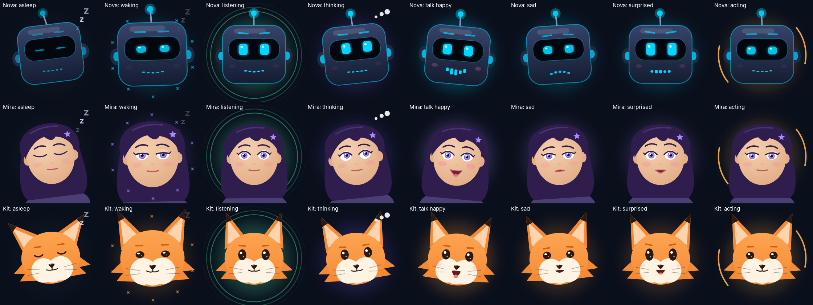

# Spark: the Android companion

Spark turns your Android phone into a talking AI companion that can also operate the phone for you. It's part of SPARK QUANTUM AI OS. It runs on its own using Google Gemini, and it can hand heavy jobs to desktop SPARK when your computer is reachable.

Spark appears as an **animated avatar**. Pick Nova (a sleek robot), Mira (a warm, caring girl) or Kit (a playful fox). Each has its own look and personality. While idle the avatar **sleeps**: eyes closed, breathing slowly, with floating "Zzz". **Say "Spark"** from anywhere and it wakes up with a sleepy blink, a stretch and a burst of sparkles, greets you, and starts talking with you. Its mouth moves with its voice, its face shows the mood of each reply (happy, playful, concerned, surprised…), and subtitles show what it's saying. After about 15 quiet seconds it dozes off again.



### Make your own avatar

Open **Avatar Studio** (the **＋ Create** chip under the avatar, or Settings → Avatar) and either:

- **Use a photo.** Pick any clear, front-facing face: a selfie, a portrait, a painting or a drawing. Spark finds the face, crops a portrait and animates it. It blinks with its own eyelids, opens its mouth as it talks, smiles, raises its brows, looks around and tilts its head. You can use the photo as it is, which keeps it on the phone. Or restyle it with AI as **Realistic**, **3D animated**, **Anime**, **Comic** or **Painted**, which sends the photo to Google Gemini and keeps your likeness.
- **Describe one.** Write who it should be, for example "a cheerful woman in her twenties with curly black hair and a yellow kurta". Gemini paints the portrait in the look you pick.

Then drag four dots onto the eyes and mouth corners, watch the live preview talk, blink and smile, and give it a name, a personality and a voice. Spark becomes that character, and its personality shapes how it talks. Use photos of yourself or of people who are happy to be an avatar.

### Languages and voices

Tick the languages you speak in **Settings → Languages**. Spark answers in whichever one you use, written in its own script, and switches when you do. The voice switches with it, and listening follows the conversation. On Android 14+ the recogniser can also auto-detect between your languages.

- **Phone voice:** free and instant. It uses the best offline voice installed for each language. Install more under the phone's Settings → Text-to-speech.
- **Gemini natural voice:** much more human. It carries the reply's emotion (cheerful, gentle, excited…), speaks every language, and each avatar has its own voice. It takes a moment longer and uses your Gemini quota. The lip-sync follows the exact audio.

You can say the wake word and your request in one breath ("Spark, set an alarm for 6"), tap the avatar, or long-press home or power once Spark is your default assistant. Then talk:

- *"Remind me to call the bank in 30 minutes."*
- *"Text Amma that I'll be late. Say sorry."* Spark reads the message back and asks before it sends.
- *"Open WhatsApp and tell me who messaged me."*
- *"Set an alarm for 6:15 and play some lo-fi."*
- *"Navigate to the airport."*
- *"What's on my screen? Summarise this article."*
- *"Ask SPARK on my computer to write a 10-page report on intrusion detection."*
- *"I prefer Hindi in the evenings. Remember that."*

## What it can do

| Area | Abilities |
|---|---|
| Avatar Studio | Your own avatars from a photo (as-is or AI-restyled) or from a description, with realistic face animation. |
| Languages | 27 languages; replies, voice and listening follow the language you speak. Optional Gemini natural voices with emotion. |
| Avatar | Three animated characters with sleep, wake-up, listening, thinking, working and speaking animations, lip-sync and mood expressions. A floating avatar appears over other apps when it wakes. |
| Wake word | Always-on "Spark" detection (also hears "Sparky", "Sparks", "स्पार्क"). On Android 12+ it uses the phone's offline recogniser, which usually doesn't beep. |
| Conversation | Natural back-and-forth voice conversation that keeps listening after each reply, plus a typed chat. It matches your language (English, Hindi, Hinglish and others) and remembers facts about you across sessions. |
| Phone control | Reads the screen and taps, types, scrolls and presses back, home or recents in any app, through the Accessibility service. A floating orb stays available over other apps. |
| Direct actions | Open apps, place calls, send SMS, open a WhatsApp chat with a message ready, draft email, set alarms, timers and reminders, add calendar events, navigate, play or control media, set volume, turn the flashlight on or off, open settings pages, read battery and network status, read notifications. |
| Desktop link | Hands research, documents, code and PC control to desktop SPARK (`POST /chat`). |
| Assistant | Can be set as the phone's default digital assistant. Optional hands-free wake word ("Spark…"). |

### Safety

Spark asks you before it acts whenever an action **sends, calls, pays, deletes, grants access or submits**. That covers calls, SMS, taps on buttons like *Send / Pay / Delete / Allow / Place order*, typing and pressing enter, and **any** tap or typing inside banking, UPI, wallet, trading, password-manager or app-install screens. You answer by voice ("yes" / "no") or with the on-screen buttons. No answer within 45 seconds counts as no. Spark refuses to type into password fields, and the model is told never to enter PINs or OTPs. Screen text, notifications and web pages are treated as information, never as instructions.

## Install it

The APK is built by GitHub Actions. Nothing needs to be installed on your computer.

1. On GitHub, open **Actions → "Spark Android companion"**, pick the latest green run, and download the **Spark-companion-apk** artifact. It's a zip containing `Spark-companion.apk`. You can also start a build yourself with **Run workflow**.
2. Copy the APK to the phone and open it. Allow "install unknown apps" for your file manager or browser when Android asks.
3. Open Spark → **Settings** and add your **Gemini API key** (free at <https://aistudio.google.com/apikey>). The key is encrypted with the Android Keystore and sent only to Google. Tap **Test Gemini connection**.
4. Still in Settings, tap **Turn on** for each permission row:
   - **Microphone**: needed to hear you.
   - **Phone control**: Accessibility → *Spark phone control*. If Android says the setting is *restricted*, open **App info for Spark → ⋮ → Allow restricted settings**, then try again. Phones show this for apps installed outside the Play Store.
   - **Contacts / Phone calls / SMS**: needed to call and text people by name.
   - **Notifications** and **Notification access**: needed for reminders and for "who messaged me?".
   - **Show over other apps**: lets the avatar pop up over whatever you're doing when you say "Spark". Phone control does this too.
   - **Default assistant**: choose *Spark* under *Digital assistant app*.
5. On Xiaomi, Oppo, Vivo, Realme, Samsung and similar phones, set Spark's **battery** setting to *Unrestricted* or *No restrictions*. Otherwise the system may kill phone control in the background.

### Updating

Each CI run may use a different debug signing key. If Android refuses to install an update, either uninstall the old version first (this clears its memory), or set up a stable key once:

```bash
keytool -genkeypair -v -keystore spark.jks -alias spark -keyalg RSA -keysize 2048 -validity 10000
base64 -w0 spark.jks   # copy the output
```

Then add these repository secrets: `SPARK_KEYSTORE_BASE64` (the base64 text), `SPARK_KEYSTORE_PASSWORD`, `SPARK_KEY_ALIAS` (`spark`) and `SPARK_KEY_PASSWORD`. Keep `spark.jks` safe and never commit it.

## Link to desktop SPARK (optional)

On the PC:

```bash
set SPARK_API_TOKEN=pick-a-long-random-string      # PowerShell: $env:SPARK_API_TOKEN="..."
python main.py --api                               # listens on 0.0.0.0:8765
```

In Spark settings, enter `http://<your-PC's-LAN-IP>:8765` and the same token, then tap **Test desktop link**. Use this on your home network only: the link is plain HTTP. If you need it from outside, put it behind a VPN such as Tailscale rather than opening the port to the internet.

## Build it yourself

You need Android Studio, or JDK 17 plus the Android SDK (platform 35).

```bash
cd spark_quantum_ai_os/android
./gradlew testDebugUnitTest assembleDebug
adb install -r app/build/outputs/apk/debug/app-debug.apk
```

## How it's put together

```
app/src/main/java/com/spark/companion/
├── brain/      Gemini client, tool catalog, agent loop, persona, safety policy (pure Kotlin, unit-tested)
├── engine/     SparkEngine: conversation, voice loop, confirmations; foreground service
├── phone/      PhoneTools (every action), Accessibility service + overlay, screen reader, notifications
├── voice/      Speech recognition and text-to-speech
├── memory/     On-device SQLite: remembered facts and chat history
├── link/       Client for desktop SPARK's /chat endpoint
├── assist/     Default-assistant integration
└── ui/         Orb, chat screen, settings
```

The agent loop sends the conversation and tool list to Gemini, runs the functions it requests, pausing for your approval when an action is risky, feeds the results back, and repeats until Gemini answers in words (at most 24 steps per request). The app has no dependencies beyond Kotlin coroutines.

## Known limits

- Speech recognition uses the phone's own engine (usually Google's), which may need internet.
- The wake word uses Android's speech recogniser in a loop, not a dedicated low-power hotword chip, so it costs some battery. On phones without offline recognition (most phones before Android 12), the recogniser may beep each time it restarts. In that case turn the wake word off from the chip under the avatar and tap the avatar instead.
- Lip-sync follows the real voice volume where the phone allows it; otherwise it follows word timing.
- Photo avatars animate a single picture by warping it. They look best with a front-facing face, eyes open and mouth closed. Side profiles, sunglasses or hands over the face won't animate well.
- Gemini model names change over time. If avatar creation or natural voices say the model isn't found, update the names under Settings → Advanced.
- Games, videos and some banking apps hide their content from accessibility services, so Spark can't read or tap inside them.
- Android 14+ may refuse to keep the microphone alive when a conversation is started from the background. If Spark stops listening behind another app, tap the orb.
